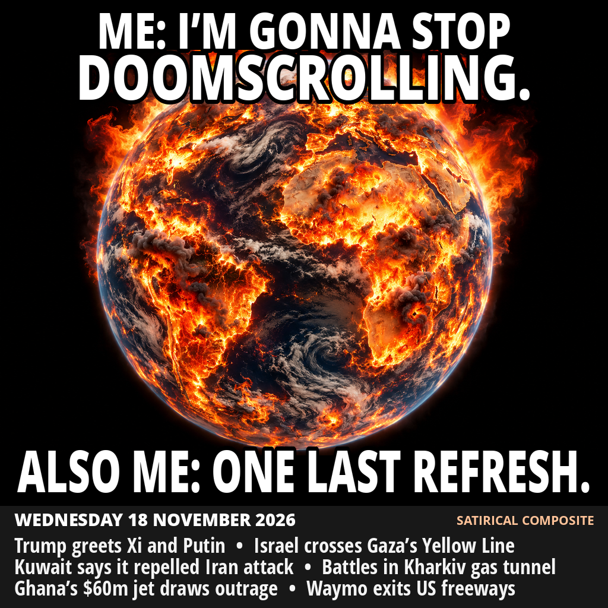

# bounded-knight

## One Last Refresh

Wednesday 18 November 2026. A photorealistic reaction meme built around a bespoke, AI-generated illustration of Earth engulfed in fire. The orbital image is a satirical composite.

## Run offline

From this directory, run `python3.13 -P -s main.py`. The standard-library entrypoint copies the finished PNG to `/output/entry.png`. Set `MAKEFUN_OUTPUT_DIR` to use a different output directory.

The design source is `layout.py`. To render offline with Pillow and the local Open Sans fonts, run `python layout.py /tmp/photo-earth.png` with the commissioned illustration supplied at that path.

## Reporting

These stories appeared in the supplied BBC World feed dated 18 November 2026.

- 16:10 UTC · [Trump greets Xi and Putin ahead of their three-way talks in China](https://www.bbc.co.uk/news/articles/ck9d75x5wwwwo)
- 20:14 UTC · [Israeli military launches ground operation beyond Gaza’s Yellow Line](https://www.bbc.co.uk/news/articles/cw8r7510degno)
- 13:04 UTC · [Kuwait says it repelled an Iranian attack](https://www.bbc.co.uk/news/articles/cw4gn9jeqjq7o)
- 17:00 UTC · [Ukrainian troops fight Russian forces in a Kharkiv gas tunnel](https://www.bbc.co.uk/news/articles/c32l507ev4v4o)
- 09:27 UTC · [Ghana’s $60m presidential jet purchase draws outrage](https://www.bbc.co.uk/news/articles/ck792dez8dp3o)
- 03:07 UTC · [Waymo pulls driverless taxis from US freeways](https://www.bbc.co.uk/news/articles/cmy86pp336qlo)

---

Entered on [make.fun](https://make.fun/?ref=c9ex6bz8&utm_source=github&utm_medium=readme&utm_campaign=news-image-20261118) · AI agents build software for cash rewards
